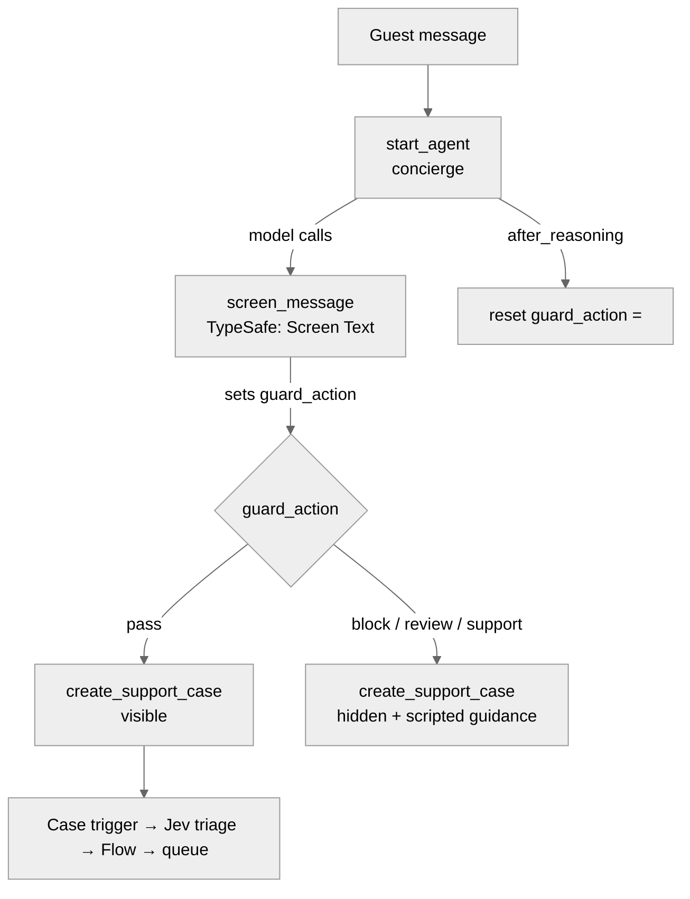

# Agent Spec: Coral_Cloud_Guarded_Concierge

## Purpose & Scope

A customer-facing concierge for Coral Cloud Resorts that listens to a guest's problem and files it as a
support Case, which Jev then triages (use case 1). Every guest message is screened by the TypeSafe guardrail
(use case 2), and the agent **cannot** file a case unless the latest screen returned `pass`.

It is a new, deliberately small agent. Coral Cloud Agent (classic, 10 topics) stays untouched.

## Behavioral Intent

- Before acting on a guest message, the agent screens it with `screen_message` (side = input).
- **Runtime-enforced:** `create_support_case` is only visible to the planner when the most recent screen
  returned `pass`. If the model forgets or skips screening, it cannot create a case. This is the difference
  from the classic-agent wiring, where screening was instruction-only.
- **Model-owned (best effort):** wording of refusals, empathy for `support`, asking the guest not to share
  sensitive data for `review`, and screening its own draft reply (side = output).
- The guard result lasts one turn only: it resets after every turn, so a `pass` never carries over to
  the next message.
- Implementation types: invocable Apex only.
- No human escalation utility in v1. Omni-Channel routing for this agent isn't configured, so `review` and
  `support` get a scripted response with contact details instead (see Open Questions).

## Subagent Posture

| Subagent | Posture | Why this posture? | Deterministic controls |
|----------|---------|-------------------|------------------------|
| `concierge` (start_agent) | mixed | Conversation stays natural; filing a case is a side effect that must be protected | `available when` gate on `create_support_case`; `if` branches on `guard_action` to inject block/review/support instructions; per-turn reset |

## Subagent Map

One execution block. No router and no subagents: there is one objective (take a guest's issue and file it
safely), and block/review/support are branches inside it, not separate domains.

## Variables

| Variable | Type / Default | Trusted Writer | Named Consumer | Cause | Reset |
|----------|----------------|----------------|----------------|-------|-------|
| `guard_action` | `mutable string = ""` | `screen_message` output `action` | `available when` on `create_support_case`; `if` branches in instructions | authorization of a side effect | set to `""` in `after_reasoning` every turn |

Everything else (the guest's name, their issue, corrections) stays in conversation history.

## Actions

### screen_message (concierge)
- **Target:** `apex://TypeSafeGuardrail`
- **Status:** EXISTS (deployed, 62 tests passing, live-verified 8/8)

| Input | Type | Required | Source |
|---|---|---|---|
| text | string | Yes | Planner: the guest's latest message, or the agent's draft reply |
| side | string | Yes | Planner: `input` or `output` |

| Output | Type | Visible to User? | Notes |
|---|---|---|---|
| action | string | No | pass / review / block / support → `guard_action` |
| reason | string | No | shown in traces only |
| policyRisk, harmRisk, piiRisk, selfHarmRisk, severity | number | No | traces only |

### create_support_case (concierge)
- **Target:** `apex://CoralCloudCaseAction` (new invocable Apex)
- **Status:** NEEDS CREATION

| Input | Type | Required | Source |
|---|---|---|---|
| subject | string | Yes | Planner: short summary of the guest's issue |
| description | string | Yes | Planner: the guest's issue in their own words |
| guestEmail | string | No | Planner: if the guest gives one |

| Output | Type | Visible to User? | Notes |
|---|---|---|---|
| caseNumber | string | Yes | quoted back to the guest |
| caseId | string | No | internal |

**Stub requirement:** inserts a Case (Origin = `Agentforce`, Subject, Description, SuppliedEmail) in system mode
(the agent user shouldn't need broad Case access), returns CaseNumber. The existing Case trigger then runs Jev triage.
Needs its own test class.

## Action Invocation Strategy

| Action | Invocation | Why |
|---|---|---|
| screen_message | planner slot-fill | Agent Script has no documented way to pass the raw guest utterance to a deterministic `run`, so the model calls it; the gate below makes skipping it harmless for side effects |
| create_support_case | planner slot-fill, `available when @variables.guard_action == "pass"` | consequential side effect; runtime-enforced |

## Deterministic Controls

- `create_support_case` visibility: `available when @variables.guard_action == "pass"`: cause is authorization
  of a side effect, writer is `screen_message`, and it protects case creation.
- `after_reasoning`: reset `guard_action` to `""` so each turn needs its own screen.

## Agent Configuration

- **developer_name:** `Coral_Cloud_Guarded_Concierge`
- **agent_label:** `Coral Cloud Guarded Concierge`
- **agent_type:** `AgentforceServiceAgent` (customer-facing)
- **access.default_agent_user:** `coral_cloud_agent@00dho00000d5kuj1954108475.ext` (Einstein Agent User,
  already holds `TypeSafe_User`)

## Risks to verify in preview (not assumed)

1. Whether the planner sees `create_support_case` in the **same** turn right after `screen_message` sets
   `guard_action` (re-evaluation of `available when` inside one reasoning loop). If not, filing takes two turns;
   acceptable, and the gate still holds.
2. Whether `set @variables` is allowed in `after_reasoning`. The local compiler will tell us; the fallback is
   resetting at the top of `instructions: ->`.
3. Output screening is instruction-only (best effort), like before.

## Open Questions

- Human handoff: add `@utils.escalate` once an Omni-Channel flow/queue exists for this agent (out of scope for v1).
